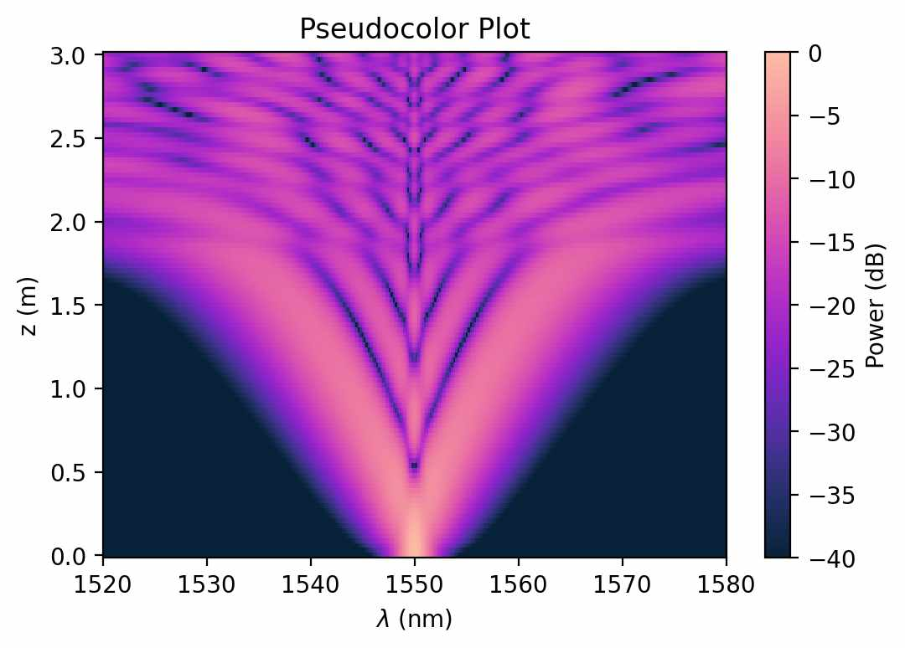
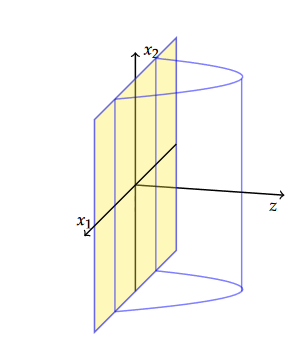
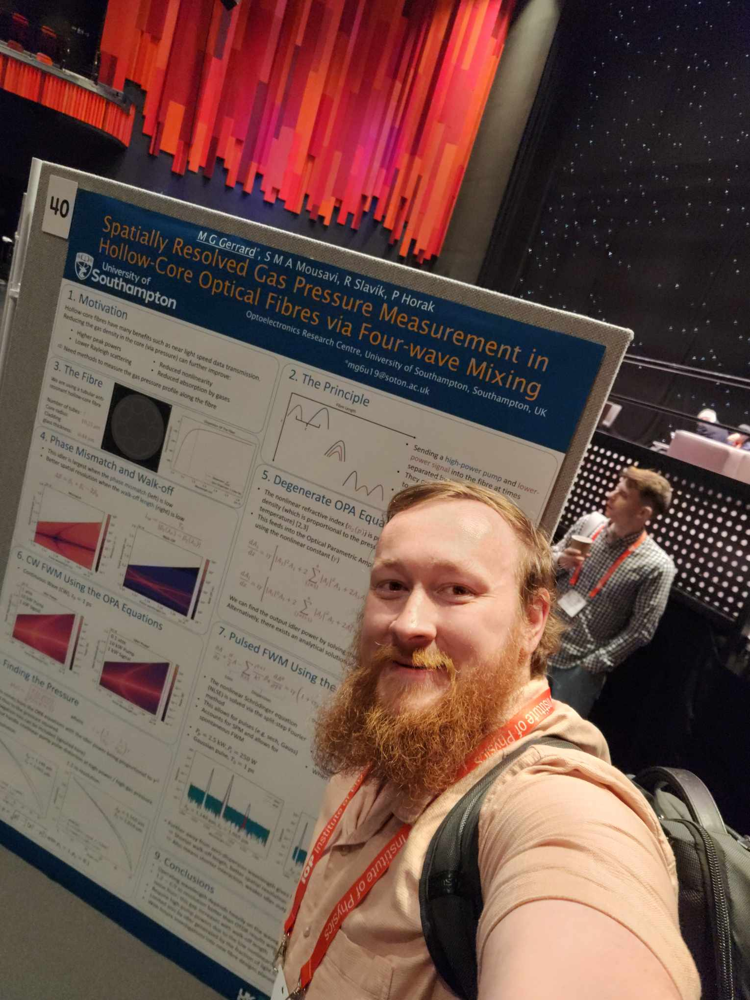

---
# Feel free to add content and custom Front Matter to this file.
# To modify the layout, see https://jekyllrb.com/docs/themes/#overriding-theme-defaults

layout: default
---
<section id="one" class="wrapper spotlight style1">
    

        
        

            <h2 class="major">Current work</h2>
            
Currently, I am using nonlinear optics to find the pressure in hollow-core fibres numerically.

            <a href="{{ '/Current_work/Current_work' | relative_url }}" class="special">Learn more</a>
        

    

</section>
<section id="two" class="wrapper alt spotlight style2">
                

                    
                    

                        <h2 class="major">Previous Work</h2>
                        
I studied  ADSd+1/CFTd and the Ryu–Takayanagi conjecture.

                        <a href="{{ '/previous_work/previous_work' | relative_url }}"  class="special">Learn more</a>
                    

                

            </section>

<section id="three" class="wrapper spotlight style3">
    

        
        

            <h2 class="major">Conferences</h2>
            
The conferences I have been to including Photon24, CLEO Europe and Photonic Europe

            <a href="{{ '/confrences/confrences' | relative_url }}"  class="special">Learn more</a>
        

    

 </section>

<section id="four" class="wrapper alt spotlight style4">
    

        
        

            <h2 class="major">All Posts</h2>
            
Explore my projects, research, experiments, and lessons learned across physics, programming, and machine learning.

            <a href="{{ '/posts/' | relative_url }}" class="special">View all posts</a>
        

    

</section>